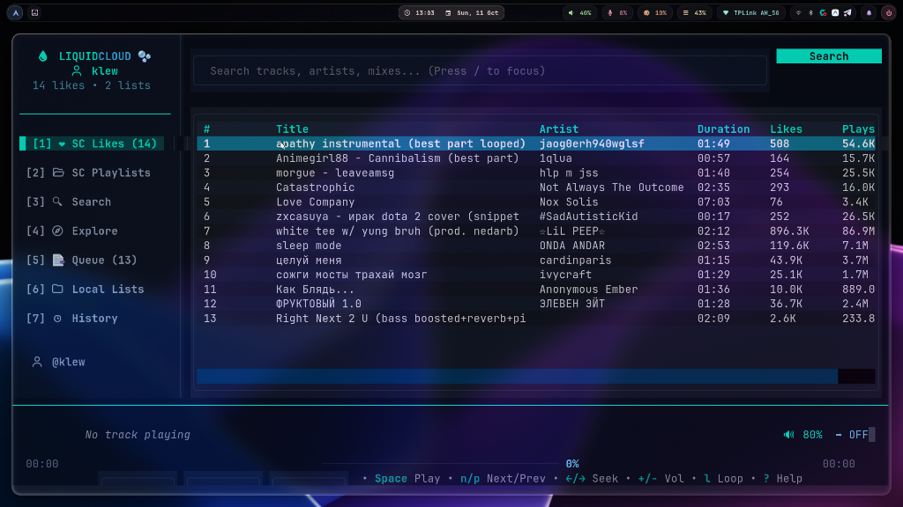
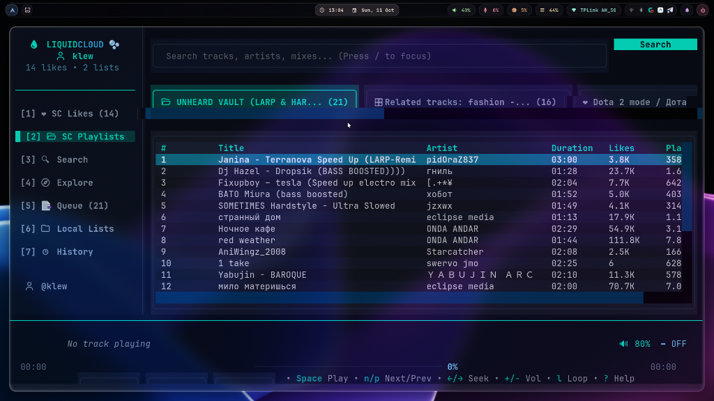
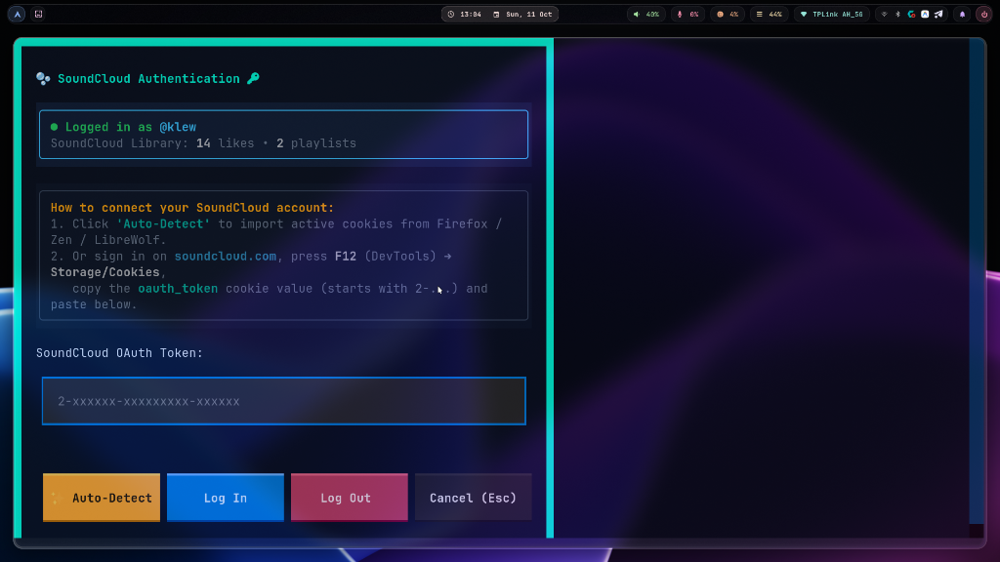

<div align="center">

```
  __    _                 _     _  _____  _                 _ 
 / /   (_)               (_)   | |/ ____|| |               | |
| |     _   __ _  _   _   _  __| | |     | |  ___   _   _  __| |
| |    | | / _` || | | | | |/ _` | |     | | / _ \ | | | |/ _` |
| |___ | || (_| || |_| | | || (_| | |____ | || (_) || |_| || (_| |
 \____/|_| \__, | \__,_| |_| \__,_|\_____||_| \___/  \__,_| \__,_|
              | |                                                 
              |_|         Liquid Glass SoundCloud Client          
```

# 💧 LiquidCloud 🫧

**A modern, hyper-fast SoundCloud Terminal User Interface with Liquid Glass aesthetics.**

[](https://www.python.org/)
[](LICENSE)
[](https://kernel.org)
[](https://textual.textualize.io/)
[](https://mpv.io/)

<br><br>

<p align="center">
  
</p>

<p align="center">
  
  
</p>

</div>

---

## ✨ Features

- 🫧 **Liquid Glass Interface**: High-contrast, glowing glass UI (`#00f5d4` cyan, `#38bdf8` ice blue, `#a78bfa` lavender) with smooth responsive layouts.
- ⚡ **Direct SoundCloud V2 Streaming**: Instant track playback without web clutter or ads.
- 🔄 **Autonomous Auto-Progression**: Reliable continuous playback with MPV IPC event monitoring — tracks seamlessly proceed one after another.
- 🔑 **SoundCloud Account Integration**:
  - ✨ **One-Click Auto-Detect**: Instantly imports your authenticated session from Firefox, Zen, LibreWolf, or Floorp cookies.
  - 📝 **Manual Token Input**: Press `L` anytime to paste your `oauth_token` directly in the built-in authentication modal.
  - 👤 Real-time user profile sync (username, likes counter, playlist stats).
- ❤️ **Full Library Sync**: Access your cloud Likes, SoundCloud Playlists, and offline Local Playlists.
- 🧭 **Explore & Search**: Live search across millions of tracks and playlists, plus curated genre explore (Phonk, Lo-Fi, Synthwave, Techno, Rock, Gaming).
- 📑 **Playback Queue & History**: Dedicated queue manager with shuffle, single track loop, and queue loop modes.
- 🚀 **Zero-Dependency Binary**: Available as a standalone one-file Linux executable — run it anywhere without even installing Python!

---

## 📥 Installation

### 1. Arch Linux / CachyOS / Manjaro

#### Requirements
```bash
sudo pacman -S --needed mpv python python-pip git
```

#### Install from source:
```bash
git clone https://github.com/Basba3/liquidcloud.git
cd liquidcloud

# Create virtual environment and install dependencies
python3 -m venv .venv
source .venv/bin/activate
pip install -r requirements.txt

# Create launcher symlink (optional)
mkdir -p ~/.local/bin
ln -sf "$(pwd)/run.sh" ~/.local/bin/liquidcloud
```

Now you can run `liquidcloud` from any terminal!

---

### 2. Ubuntu / Debian / Linux Mint / Pop!_OS

#### Requirements
```bash
sudo apt update
sudo apt install -y mpv python3 python3-pip python3-venv git
```

#### Install via Git:
```bash
git clone https://github.com/Basba3/liquidcloud.git
cd liquidcloud

python3 -m venv .venv
.venv/bin/pip install -r requirements.txt

# Link to local bin
mkdir -p ~/.local/bin
ln -sf "$(pwd)/run.sh" ~/.local/bin/liquidcloud

# Ensure ~/.local/bin is in your PATH:
export PATH="$HOME/.local/bin:$PATH"
```

#### Or install via `pipx` (Isolated CLI application):
```bash
sudo apt install -y pipx
pipx ensurepath
pipx install git+https://github.com/Basba3/liquidcloud.git
```

---

### 3. Standalone Pre-Built Binary (No Python required!)

You only need `mpv` installed on your machine (`sudo apt install mpv` / `sudo pacman -S mpv`).

```bash
# 1. Download the latest binary from GitHub Releases
curl -L -o liquidcloud https://github.com/Basba3/liquidcloud/releases/latest/download/liquidcloud

# 2. Make it executable
chmod +x liquidcloud

# 3. Move to your PATH
sudo mv liquidcloud /usr/local/bin/
```

Launch with:
```bash
liquidcloud
```

---

### 4. Build Binary from Source (PyInstaller)

To build your own standalone portable binary:

```bash
git clone https://github.com/Basba3/liquidcloud.git
cd liquidcloud

# Run the build script
./build_bin.sh
```

The resulting standalone binary will be generated at:
```bash
./dist/liquidcloud
```
You can copy this file to any Linux system and run it directly!

---

## 🔑 SoundCloud Account & Authentication

LiquidCloud works out of the box in **Guest Mode** for searching and streaming any public track.

To access your personal **SoundCloud Likes** and **Playlists**:

1. Press **`L`** anywhere in LiquidCloud to open the **Account Modal**.
2. **Method 1 (Automatic)**: Click **`✨ Auto-Detect`**. LiquidCloud will scan local browser cookies (Firefox, Zen Browser, LibreWolf) and log you in instantly.
3. **Method 2 (Manual)**:
   - Open [soundcloud.com](https://soundcloud.com) in your browser and sign in.
   - Open Developer Tools (**F12**) ➔ **Storage** (or **Application**) ➔ **Cookies** ➔ `https://soundcloud.com`.
   - Find and copy the value of `oauth_token` (starts with `2-`).
   - Paste it into LiquidCloud and click **`Log In`**.

Your token is safely stored locally in `~/.config/liquidcloud/auth.json`.

---

## ⌨️ Keybindings

| Key | Action |
| :--- | :--- |
| **`Space`** | Play / Pause |
| **`Enter`** | Play highlighted track immediately |
| **`↑ / ↓`** | Navigate track list |
| **`← / →`** | Seek -5s / +5s |
| **`Shift + ← / →`** | Seek -30s / +30s |
| **`n`** | Next track in queue |
| **`p`** | Previous track |
| **`+` / `=`** | Volume Up (+5%) |
| **`-` / `_`** | Volume Down (-5%) |
| **`m`** | Mute / Unmute |
| **`l`** | Cycle loop mode: Off ➔ Single Track ➔ Queue |
| **`z`** | Toggle shuffle |
| **`a`** | Add selected track to Queue |
| **`f`** | Toggle Favorite (❤️) |
| **`d` / `Delete`** | Remove track from queue or playlist |
| **`c`** | Clear playback queue |
| **`P` *(Shift+p)*** | Add selected track to a Local Playlist |
| **`1`** | Tab: SoundCloud Likes (❤️) |
| **`2`** | Tab: SoundCloud Playlists (📂) |
| **`[` / `]`** | Switch between playlists |
| **`3`** | Tab: Track & Playlist Search (🔍) |
| **`4`** | Tab: Explore by Genre (🧭) |
| **`5`** | Tab: Active Playback Queue (📑) |
| **`6`** | Tab: Local Playlists (📁) |
| **`7`** | Tab: Playback History (🕒) |
| **`/`** | Focus Search Bar |
| **`u`** | Open direct SoundCloud URL (track/playlist/artist) |
| **`L`** | Open SoundCloud Account & Login dialog (🔑) |
| **`?`** | Help dialog |
| **`q`** | Quit application |

---

## 🛠️ Architecture & Tech Stack

```
LiquidCloud
├── liquidcloud/
│   ├── api.py           # SoundCloud v2 API client, token finder, stream resolver
│   ├── app.py           # Textual UI engine, view router, key handler
│   ├── player.py        # Asynchronous MPV IPC socket player & auto-advancement
│   ├── queue_manager.py # Queue ordering, shuffle & loop algorithms
│   ├── storage.py       # Local state persistence (~/.config/liquidcloud)
│   ├── styles.tcss      # Liquid Glass color palette & responsive styles
│   └── ui/
│       ├── modals.py    # LoginModal, HelpModal, UrlModal, PlaylistModals
│       ├── player_bar.py# Real-time scrub bar, badges & playback status
│       ├── sidebar.py   # Acrylic glass navigation sidebar & account pill
│       └── track_table.py# High-performance DataTable track list
├── build_bin.sh         # PyInstaller standalone one-file packaging script
├── pyproject.toml       # Modern Python build specifications
└── .github/workflows/   # Automated CI/CD release binaries
```

---

## 📜 License

Distributed under the **MIT License**. See `LICENSE` for more information.

---

<div align="center">
Made with 💧 by <a href="https://github.com/Basba3">Basba3</a>
</div>
